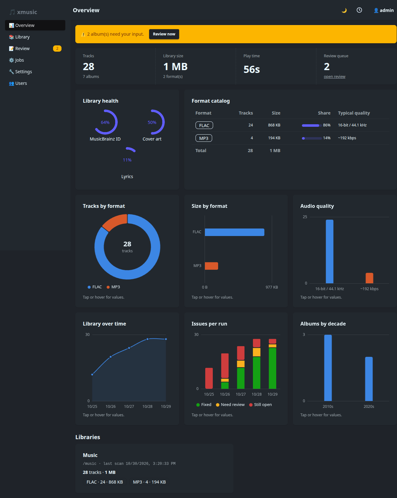

# xmusic

Self-hosted music metadata fixer. xmusic scans your library, matches albums against
[MusicBrainz](https://musicbrainz.org) (with [AcoustID](https://acoustid.org) fingerprints for badly tagged
files, and [Discogs](https://www.discogs.com) for releases MusicBrainz lacks), and writes correct tags, cover art ([Cover Art Archive](https://coverartarchive.org)) and lyrics
([LRCLIB](https://lrclib.net)) back into your files. It is one Rust binary with a web dashboard, built for
people who keep their music on a NAS or a home server.



## What it does

- **Fixes tags.** Albums are matched to a MusicBrainz release (by barcode, ISRC, text search or fingerprint);
  confident matches are applied, doubtful ones wait in a review queue where you can see every change before
  approving it.
- **Adds covers and lyrics.** Missing covers are fetched, small ones can be upgraded, lyrics (synced when
  available) are embedded or saved as `.lrc`. Artist photos can be saved as `artist.jpg` for Navidrome.
- **Checks library health.** Missing or skipped track numbers, wrong disc numbers, mixed album artists,
  artist spellings and lossy files in FLAC albums, most with a one-click fix.
- **Finds duplicates.** The same album in two folders or formats is grouped; keep one copy and the others move to
  a trash folder you can restore from.
- **Is safe.** Every change is logged first and can be undone. xmusic never deletes music files.
- **Is light.** Each file is written at most once per run, file work is bounded by a setting, and MusicBrainz
  is queried at 1 request per second. It works on local disks and is gentle on network mounts (NFS, SMB, rclone).
- **Runs unattended.** Cron schedule, watch mode, a Lidarr import hook, Gotify notifications and a Navidrome
  rescan after changes. The database can be backed up and restored from the dashboard.
  Prometheus metrics and a Grafana dashboard are included.

## Quick start

```sh
git clone <this repo> xmusic && cd xmusic
# edit docker-compose.yml: point the /music volume at your library
docker compose up --build -d
```

Open <http://localhost:8337>, create the admin account, add `/music` as a library in **Settings → Libraries**
and press **Run now** on the Jobs page. The full walkthrough is in [Getting started](docs/getting-started.md).

Without Docker: `cargo run --release` (needs Rust; `ffmpeg` only for the test suite).

## Documentation

| Topic | What is in it |
|-------|---------------|
| [Getting started](docs/getting-started.md) | Install, first login, libraries, environment variables, password reset |
| [The dashboard](docs/dashboard.md) | A tour of every page, with screenshots |
| [Matching and review](docs/matching-and-review.md) | How albums are matched, scored and reviewed |
| [Covers and lyrics](docs/covers-and-lyrics.md) | Where they come from and how they are stored |
| [Duplicates](docs/duplicates.md) | Finding duplicates, keeping one copy, restoring |
| [Jobs and automation](docs/jobs-and-automation.md) | Job kinds, schedule, watch mode, cancel, notifications, Navidrome |
| [Settings reference](docs/settings.md) | Every setting and its default |
| [Network mounts](docs/network-mounts.md) | Tuning for NFS, SMB and rclone mounts, and CPU limits |
| [Safety and undo](docs/safety.md) | What xmusic writes, how undo and trash work |
| [Monitoring](docs/monitoring.md) | Prometheus metrics and the Grafana dashboard |
| [Development](docs/development.md) | Code layout, tests, building and deploying |

## License

[MIT](LICENSE)
