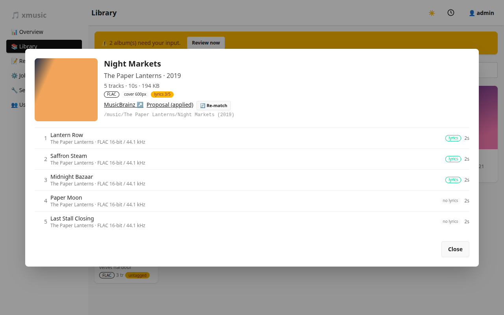

# Covers and lyrics

Both are fetched per album during the album pass of a full run, or on their own with **Jobs → Fetch covers** and
**Jobs → Fetch lyrics**. Either way, every track is still written at most once, with tags, cover and lyrics
together.

## Covers

Source: the [Cover Art Archive](https://coverartarchive.org), using the album's MusicBrainz release id, so an
album needs a release id first.

- **Embed covers** (`cover_embed`, on by default) writes the picture into each track that has none.
- **Cover size**: `250`, `500`, `1200` (default) or `original`.
- **Replace smaller covers** (`cover_upgrade_below`, default 500): an embedded cover whose shorter side is below
  this many pixels is replaced, but only by a bigger one. The old picture is stored in the undo log, so undo
  restores it. `0` disables upgrades.
- **Save cover.jpg** (`cover_save_file`) also writes the fetched cover next to the tracks.

### Cover files next to the music

A `cover.jpg`, `folder.jpg`, `cover.png` or `folder.png` in the album folder counts as the album's cover. Such an
album is not reported as missing a cover, and xmusic does not embed a picture into its tracks, because players
like Navidrome already use the file. The album view shows a *cover file* badge. This is detected during scans,
so run a scan after adding cover files.

## Lyrics

Source: [LRCLIB](https://lrclib.net), searched with the track's artist, title and album.

- **Lyrics** (`lyrics_enabled`) turns lookups on.
- **Prefer synced** picks time-stamped (LRC) lyrics when available, plain text otherwise.
- **Embed** writes a `LYRICS` tag into the file.
- **Save .lrc** writes a `.lrc` file beside the track. It is a separate small file, not a rewrite of the audio.

Tracks without a match are remembered so they are not asked about again on every run. Lookups are spaced out
(about four per second), and if LRCLIB answers with a server error (429, 502, 503, 504) xmusic retries and then
pauses lyrics for ten minutes instead of hammering it; the rest of the run carries on.

The album view shows which tracks have lyrics:

