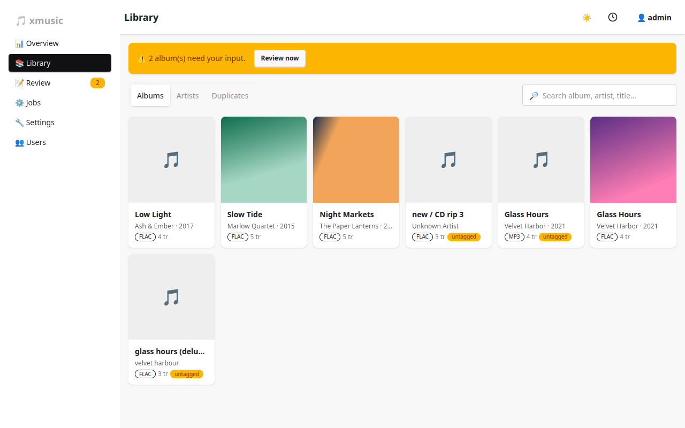
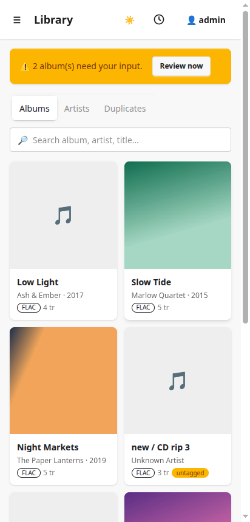

# The dashboard

The whole UI is one page served by the binary (daisyUI, no external requests). The sidebar has Overview,
Library, Review, Jobs, Settings and Users. A badge next to **Jobs** shows when a job is running, and the
Overview carries a bar with its progress and a Cancel button. The clock icon drops down the five most recent jobs, and the
sun/moon switches the theme.

## Overview

Totals, a format catalog, library health (share of tracks with a MusicBrainz id, cover and lyrics), charts of
formats and audio quality, and the review queue. The yellow banner appears whenever albums wait for you.

## Library

Three tabs: **Albums** (cover grid, with badges such as `untagged`), **Artists**, and **Duplicates**. The search
box matches album, artist and track titles.

Opening an album shows its tracks with a lyrics badge for each, the cover size, a link to the MusicBrainz
release, a link to its proposal, and a **Re-match** button.

An album with a `cover.jpg` or `folder.jpg` next to its tracks counts as having a cover and shows a
*cover file* badge.

Duplicates are covered in [Duplicates](duplicates.md).

## Review

The queue of albums that need a person: **Needs review** (a release was found, but not confidently),
**Needs manual** (nothing scored high enough), **Approved** (waiting to be written), **Applied** and **Ignored**.
Select several rows to approve, ignore or re-match them in bulk.

Opening one shows the candidates and the exact tag changes:

Old values are struck through, new ones are editable. See [Matching and review](matching-and-review.md).

## Jobs

**Run now** does a full run. The four buttons below it run one step: **Scan**, **Apply approved**,
**Fetch covers**, **Fetch lyrics**. *Maintenance* holds **Apply custom tags & rewrites** and **Undo all
changes**. Below are the open issues (albums missing an id, cover or lyrics) and the job history with how
long each phase took. See [Jobs and automation](jobs-and-automation.md).

## Settings

Five tabs: General, Libraries, Metadata, Cover & lyrics, Integrations. Admin only. See the
[Settings reference](settings.md).

## Users

Admins create users (admin or regular), change their passwords and delete them.

## On a phone

The layout adapts to narrow screens: the sidebar becomes a menu and some table columns fold into the row.

