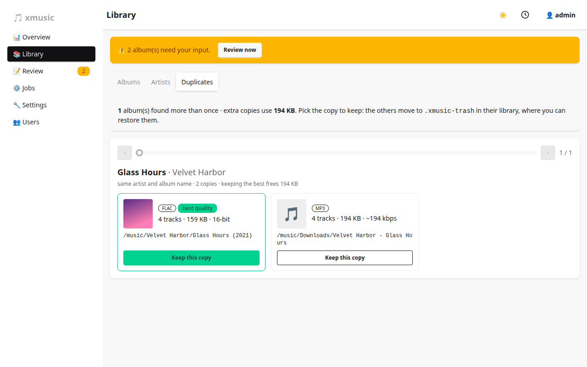

# Duplicates

**Library → Duplicates** finds albums that exist more than once, for example a FLAC rip and an MP3 download of
the same record.

## How copies are found

Two folders are the same album when they share a MusicBrainz release id, or the same artist and album name
(case-insensitive), and the same set of discs. The disc set is part of the key, so `Disc 1 X` and `Disc 2 X`
folders are two halves of one album, not copies. A tagged FLAC copy and an untagged MP3 copy still end up
together when their artist and album names match.

Albums without a value in their tags are not grouped: an empty `MUSICBRAINZ_ALBUMID` is treated as no id.

## Keeping one copy

Use the slider or the arrows to move between groups. Each copy shows its format, size, track count and bit depth;
the best quality one is marked and pre-selected. Press **Keep this copy** on the one you want: the others are
moved, not deleted.

## Where the other copies go

They are moved to `.xmusic-trash/` inside the same library, keeping their relative path, and logged in the
database. The list of trashed copies sits below the groups; admins can press **Restore** there to move one back
(a rescan follows). Scans skip the trash folder. xmusic never empties it: free the space
yourself when you are sure.

## Folders with mixed formats

A collapsible list also shows folders that hold more than one format (FLAC and MP3 side by side). A folder is
matched as one album, so mixed copies can confuse matching; keep one format per folder.
