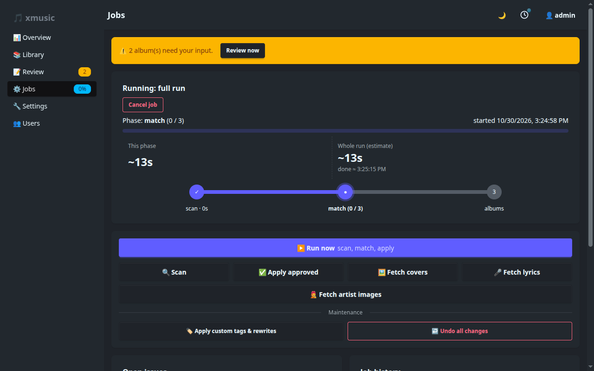

# Jobs and automation

The sidebar shows a badge next to **Jobs** while a job runs, and the Overview gets a bar for each job with its
current phase, progress, an ETA and a **Cancel** button. On the Jobs page each run is drawn as steps (for a full
run: scan → match → albums): done, current with its count, and still to come.

## Parallel jobs

**Settings → General → Max parallel jobs** (default 1) sets how many jobs run at once. With 1 they run one
after another, as before. With 2 or more, a small job (an album's Fetch lyrics, a re-match, a Lidarr import)
starts next to a long full run instead of answering "already running".

- The same job never runs twice at once: a second full run, or Fetch lyrics twice for one album, is refused.
  Fetch lyrics for two different albums is fine.
- Two jobs never write one file at the same time. The second one waits for that file, then reads it again,
  so the undo log stays right.
- MusicBrainz stays at one request per second for all jobs together, so two matching jobs aren't faster
  than one. Parallel jobs help most when they use different services (lyrics, covers) while a full run matches.
- Each job uses up to **Parallel file operations** threads, so 2 jobs × 3 can do 6 file operations at once.
- A refused start says why: the limit is reached, or the same job is already running.

## Job kinds

| Button | What it does |
|--------|--------------|
| **Run now** (full run) | Scan, then match albums without a release id, then the album pass: tags, cover and lyrics, one write per file |
| **Scan** | Walks the libraries and reads tags of new or changed files only (by modification time and size) |
| **Apply approved** | Writes approved proposals, with covers and lyrics for those albums |
| **Fetch covers** | Only the cover part of the album pass |
| **Fetch lyrics** | Only the lyrics part of the album pass |
| **Import** | Started by the [import hook](#import-hook-lidarr): a full run limited to the announced album folders |
| **Fetch artist images** | `artist.jpg` for album artists that have none (see [Covers and lyrics](covers-and-lyrics.md#artist-images)) |
| **Fix disc numbers** | Started from **Library → Health → Disc numbers**: disc and track totals from the disc folders |
| **Rename artist** | Started from **Library → Health → Artist spellings**: writes the chosen spelling to the tracks that have another one |
| **Apply custom tags & rewrites** | Applies your [rules](matching-and-review.md#rewrite-rules-and-custom-tags) everywhere |
| **Undo all changes** | Restores the original tags from the undo log |

Approving albums while a job runs never waits for the next run: albums approved during a full run or an apply
join its album pass, and after any other job an apply starts by itself.

*Re-match* (on an album) is also a job. A finished job's summary ends with how long each phase took, for example
`took scan 3m, match 41m, albums 25m`, which shows where a slow run spent its time.

## Cancel

Cancel stops a job at its next safe point: between files while scanning or writing, between lookups, and between
albums. A file that is being written is finished first, so nothing is left half written. The bar reads
"Cancelling…" until it stops.

## Schedule

**Settings → General → Scan schedule** takes a standard five-field cron expression, evaluated in the
container's time zone (`TZ`). `0 3 * * *` runs a full run every day at 03:00. Empty means no scheduled runs. A
scheduled run is skipped if a full run is already running, or the parallel job limit is reached.

## Watch mode

Turn on **Watch mode** to scan automatically when files in an enabled library change. xmusic uses inotify and
waits 30 seconds after the last change, then runs a scan, or a full run if you also tick *do a full run instead of
a scan only*.

Network shares (NFS, SMB, rclone) do not report changes to inotify. Use the schedule for those, and the
import hook below for albums that Lidarr adds.

## Import hook (Lidarr)

When Lidarr imports an album, it can tell xmusic, which then scans, matches and finishes (cover, lyrics) just
that album within seconds, instead of at the next scheduled run.

1. **Settings → Integrations → Lidarr import hook → Generate token**, then **Save settings**.
2. In Lidarr: **Settings → Connect → + → Webhook**. Set **URL** to `http://<xmusic host>:<port>/api/hook/import`
   and **Password** to the token (the Username is ignored). Or leave Password empty and put the token in the URL:
   `…/api/hook/import?token=…`. Use the address you open the dashboard with: Lidarr runs in its own container,
   so `xmusic` or `localhost` won't reach it unless both share a Docker network.
3. Tick **On Release Import**, **On Upgrade** and **On Rename**, and press **Test**.

What each Lidarr event does:

- **Imports and upgrades** start an **Import** job for those album folders: a scan of only those folders, a match
  for the ones without a release id (auto-apply works as in a full run), and the album pass for them.
- **Renames and deletes** start a normal scan.
- **Test** just answers OK. Other events are ignored.

If no job slot is free (see [Parallel jobs](#parallel-jobs)), the import waits and starts when a job ends.

The token is the only login, so treat it (and a URL containing it) like a password. Without a token the hook is off. Paths
must be the same in both containers (both mount the music at `/music`, for example).

Other tools can use the hook too: `POST /api/hook/import?token=…` with `{"path": "/music/Artist/Album"}`.

## Notifications (Gotify)

Under **Settings → Integrations**, set a [Gotify](https://gotify.net) URL and token to be notified when a job
finishes, when albums need review, and when a job fails (each can be switched off). Set **Public URL** to the
dashboard address as your phone sees it, and the notification opens the right page (Review or Jobs) when tapped.

## Navidrome

Set a Navidrome (or any Subsonic-compatible) URL, user and password under **Settings → Integrations**. After any
job that changed files, xmusic calls `startScan` so the player picks up the new tags without waiting for its own
scan.
