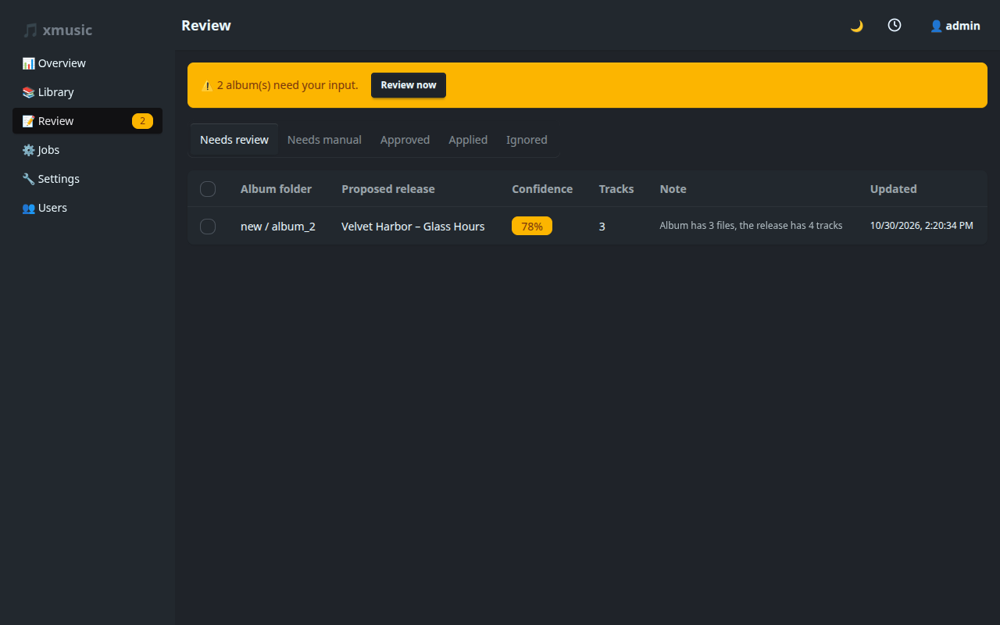
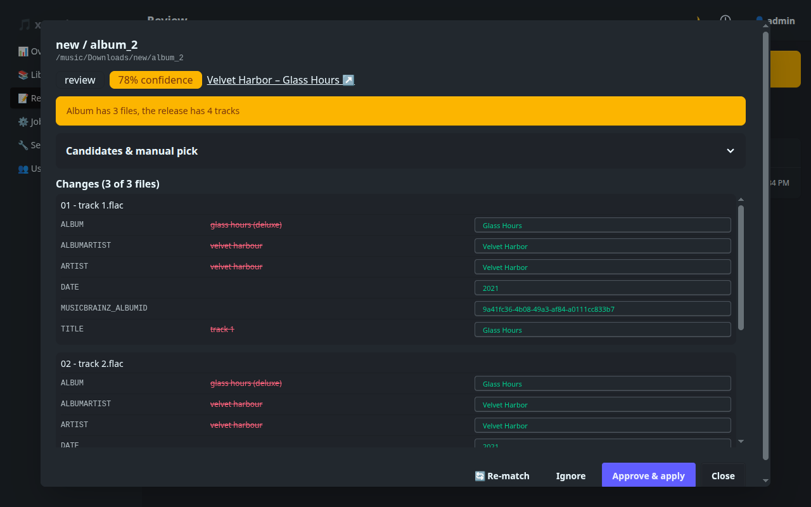

# Matching and review

## What an album is

xmusic works per album, and an album is the set of tracks in one folder. Disc subfolders (`CD1/`, `Disc 2/`,
`disk_03 - Bonus/`) count as part of their parent folder, so a two-disc album stays one album. A folder like
`Disc 1 Flow State` is *not* a disc folder, since those usually sit in an artist folder.

## How an album is matched

1. **Which albums.** A full run only matches albums that have no MusicBrainz or Discogs release id. Albums that already have
   a pending proposal, or that you ignored, are skipped.
2. **Candidates.** Exact identifiers come first, then fuzzier sources, each only while nothing is good yet:
   - a `BARCODE` tag finds the exact pressing on MusicBrainz;
   - the album's artist and title tags are searched;
   - up to three tracks' `ISRC` tags find the releases holding those recordings;
   - with an AcoustID key, up to three tracks are fingerprinted with `fpcalc`;
   - finally Discogs (by barcode when there is one, else by artist and title; see below).
3. **Scoring.** A track whose `ISRC` or fingerprint names a release track's recording is matched for certain,
   and so is a track at the right position and length on a release with the same barcode; those also lift the
   album's confidence even when its titles are junk. Otherwise each candidate gets a confidence from 0 to 1
   based on how well artist, album title, track count
   and track titles/lengths line up. Releases from your preferred countries and media (`XW`, `US`; Digital
   Media, CD by default) win ties.
4. **Track alignment.** Local files are matched to release tracks, so a file named `track 2` gets the right title
   even when the order of names does not help.
5. **Proposal.** The best candidate becomes a proposal: per file, the tag changes needed.

The search stops at the first candidate that scores above the auto-apply threshold with every track aligned,
which saves MusicBrainz calls. MusicBrainz is queried at most once per second, as their rules require.

## Discogs

Discogs lists many pressings, small labels and bootlegs that MusicBrainz doesn't have. When MusicBrainz (and
AcoustID) find nothing above the **match threshold**, xmusic searches Discogs with the same artist and album and
scores up to three releases the same way. Discogs candidates carry a *Discogs* badge in the proposal.

- Turn it off with **Settings → General → Search Discogs**. It works without an account; a personal access token
  (discogs.com → Settings → Developers) raises the limit from 25 to 60 lookups a minute.
- A Discogs match writes the usual tags plus `DISCOGS_RELEASE_ID`, never `MUSICBRAINZ_*` ids. `ORIGINALDATE` is
  left out (Discogs keeps it on the master release), and the genre is Discogs' broad one, such as *Rock*.
- Covers come from the Cover Art Archive, which needs a MusicBrainz id, so Discogs-matched albums get no
  cover from xmusic. A `cover.jpg` in the folder still counts.
- You can paste a Discogs release link (`https://www.discogs.com/release/14335422-…`) in the proposal's manual
  pick box, just like a MusicBrainz one.

## What happens next

| Confidence | Result |
|------------|--------|
| At or above **auto-apply above** (default 0.95) | Written without review (set it to 0 to always review) |
| Between **match threshold** (0.80) and auto-apply | **Needs review**: you approve or ignore it |
| Below the match threshold | **Needs manual**: pick a candidate or paste a release link |

Jobs never wait for a person. Albums that need you are parked in Review and reported when the run ends (a
notification, if configured).

## Reviewing

Open a row to see the proposal:

- **Candidates & manual pick** lists other releases with their score. **Use** switches the proposal to that
  release; you can also paste a MusicBrainz release link or id.
- **Changes** show each file's old values struck through and the new ones in editable fields. Edit a value and
  it is saved with the proposal.
- **Approve & apply** writes the album. **Ignore** hides it for good. **Re-match** searches again.

Bulk actions work from the list: tick rows, then approve, ignore or re-match them together.

### Re-matching an album that already has an id

**Re-match** (in the album view or on a proposal) scores the album's own release too. The result always goes to
Review and is never auto-applied, so you can see what would change. If nothing differs, the album is marked
applied.

## Which tags are written

Only the fields in **Write fields** (default `TITLE, ARTIST, ALBUM, ALBUMARTIST, DATE, ORIGINALDATE, TRACKNUMBER,
TRACKTOTAL, DISCNUMBER, DISCTOTAL, GENRE, LABEL, CATALOGNUMBER, BARCODE, MUSICBRAINZ_*, DISCOGS_*`) are changed, and fields in **Preserve fields** (`COMMENT`,
`REPLAYGAIN_*`) are never overwritten. Patterns end in `*`.

- `GENRE` is the release's most voted MusicBrainz genre, or its release group's when the release has none.
- `ORIGINALDATE` is the release group's first release date; `DATE` is this release's date.
- `LABEL` and `CATALOGNUMBER` come from the release's first label entry.
- `BARCODE` is the release's, so a later re-match is exact. `ISRC` is never written: a recording can have
  several, and the file's own value is kept.

Albums applied before these fields existed get them with a **Re-match**.

### Rewrite rules and custom tags

- **Rewrite rules** edit values with a regular expression, per field (for example turn `feat.` into `feat`).
- **Custom tags** add a fixed tag, for example `COLLECTION=Vinyl rips`. The scope is `all`, `path:/music/x` (a
  folder prefix) or `FIELD=value` (case-insensitive match on another tag).

**Jobs → Apply custom tags & rewrites** applies both everywhere without matching.
