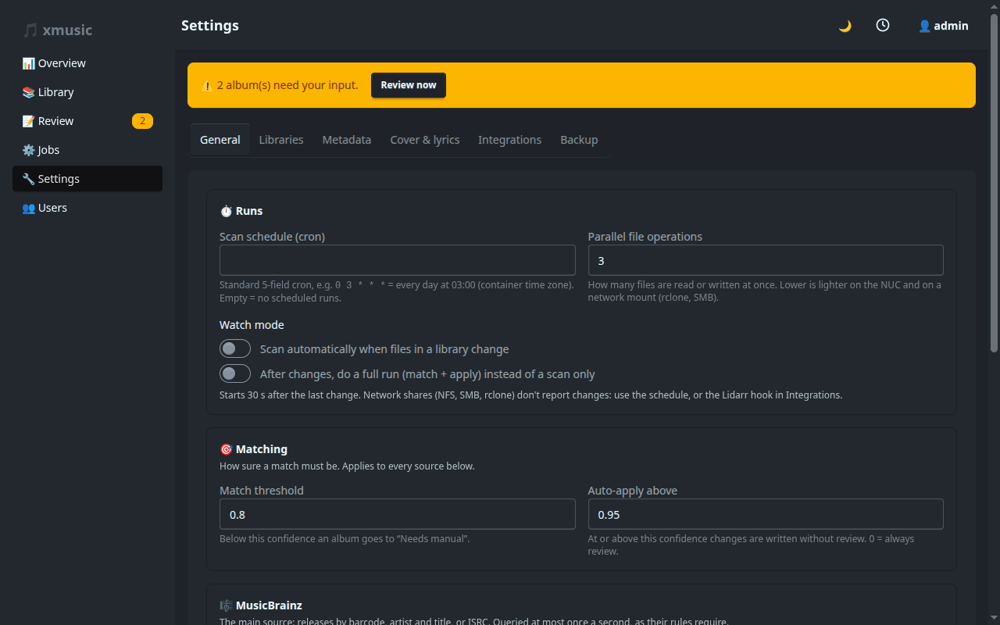

# Settings reference

Settings, libraries and users are admin-only. Everything lives on **Settings**, in six tabs, and is stored as one
JSON document in the database. Changes apply to the next job; the schedule and watch mode reload immediately.

## General

| Setting | Default | Meaning |
|---------|---------|---------|
| Scan schedule | empty | Cron expression for a scheduled full run, e.g. `0 3 * * *` |
| Contact e-mail | empty | Sent in the MusicBrainz User-Agent, as their API rules require |
| Match threshold | 0.80 | Below this confidence an album goes to *Needs manual* |
| Auto-apply above | 0.95 | At or above this confidence changes are written without review. 0 = always review |
| Parallel file operations | 3 | How many files are read or written at once. Lower is lighter on the CPU and on network mounts |
| AcoustID API key | empty | Enables fingerprint matching for badly tagged files. Use an *application* key; **Test key** checks it and `fpcalc` |
| Search Discogs | on | Second source when MusicBrainz has no good match |
| Discogs token | empty | Optional personal access token: 60 lookups a minute instead of 25 |
| Watch mode | off | Scan (or run fully) 30 s after files in a library change |

## Libraries

Add a library by name and path (as seen by the container), switch it on or off, or forget it. Forgetting never
touches files.

## Metadata

| Setting | Default | Meaning |
|---------|---------|---------|
| Write fields | `TITLE, ARTIST, ALBUM, ALBUMARTIST, DATE, ORIGINALDATE, TRACKNUMBER, TRACKTOTAL, DISCNUMBER, DISCTOTAL, GENRE, LABEL, CATALOGNUMBER, BARCODE, MUSICBRAINZ_*, DISCOGS_*` | Fields xmusic may change. A trailing `*` is a prefix |
| Preserve fields | `COMMENT, REPLAYGAIN_*` | Never overwritten |
| Preferred countries | `XW, US` | Tie-breaker between releases |
| Preferred media | `Digital Media, CD` | Tie-breaker between releases |
| Rewrite rules | none | Field, regular expression, replacement |
| Custom tags | none | Key, value and scope (`all`, `path:/folder`, `FIELD=value`) |

## Cover & lyrics

| Setting | Default |
|---------|---------|
| Embed covers | on |
| Save cover.jpg next to the tracks | off |
| Cover size | 1200 (`250`, `500`, `1200`, `original`) |
| Upgrade covers smaller than (px) | 500 (0 = never) |
| Save artist.jpg during full runs | off |
| Shrink covers larger than (px) | 0 (never) |
| Lyrics lookup | on |
| Prefer synced lyrics | on |
| Embed lyrics in the file | on |
| Save .lrc file | off |

Details: [Covers and lyrics](covers-and-lyrics.md).

## Integrations

| Setting | Meaning |
|---------|---------|
| Gotify URL, token, priority | Push notifications (priority default 5) |
| Notify when finished / needs review / failed | Each on by default |
| Public URL | Dashboard address as seen from your phone; notifications link to it |
| Navidrome URL, user, password | Rescan after xmusic changes files. Empty = off |
| Hook token | Enables the [Lidarr import hook](jobs-and-automation.md#import-hook-lidarr). Empty = off |

The AcoustID key, Discogs token, Gotify token, Navidrome password and hook token are secrets: the dashboard shows them masked and never
receives the stored value. Leave the mask to keep a secret, type a new one to replace it, or clear the field to
remove it.

Details: [Jobs and automation](jobs-and-automation.md).

## Backup

- **Download backup** saves the whole database as one file (`xmusic-YYYY-MM-DD.db`): settings, users,
  libraries, proposals, job history and the undo log. It is a consistent copy, so you can take it while a job
  runs. Your music is not in it.
- **Restore** uploads such a file and replaces everything with it, including users and passwords, so you may
  have to log in again. xmusic checks first that the file is an xmusic database with an admin, and refuses
  backups from a newer version. The current database is kept as `xmusic-before-restore.db` in the data folder,
  older backups are migrated, and a scan follows to catch up with the library. Restore is refused while a job runs.

The data folder (`/data` in the container) can also be backed up as files, but only while xmusic is stopped.
